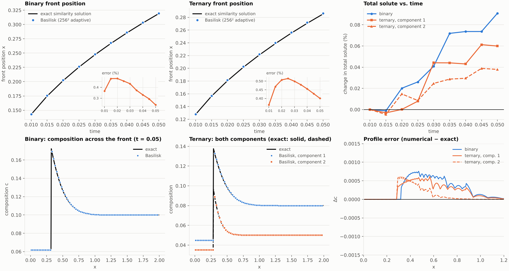

# sharp-interface-claude

**An open-source, research-grade sharp-interface solver for N-component alloy solidification** — coupled solute
diffusion in both phases, interface thermodynamics from phase free energies, anisotropic capillarity and kinetics,
and either a prescribed or an evolving temperature field.

> **Status: research code under active development.** This project is a human–AI research collaboration: the
> model formulation, derivations, and code were developed together with [Claude](https://www.anthropic.com/claude)
> (Anthropic), under the direction of the repository owner, for research purposes. Nothing here has been peer
> reviewed or independently audited, and large parts are **not yet validated** (see [Status](#status-and-validation)).
> Treat results as research output, not as a validated engineering tool, and check anything you rely on.

---

## Why this exists: the gap

Simulating microstructure formation in multicomponent alloys is dominated by **phase-field** codes, which describe
the interface as a thin diffuse region with its own thermodynamics. That is powerful, but for some questions it is
the wrong tool:

- the physical interface is *sharp* (a few atoms), while a phase-field interface must be made orders of magnitude
  wider for computation, so thin-interface artefacts (spurious solute trapping, interface-width dependence,
  anomalous effects when diffusivities differ between phases) have to be engineered away;
- many problems are naturally posed as a **free-boundary (Stefan) problem** with explicit interface conditions:
  Gibbs–Thomson capillarity, kinetic undercooling, solute partitioning, solute trapping.

Sharp-interface numerical methods exist, but the open ones cover only slices of the problem:

| work | what it provides | what it does not |
|---|---|---|
| Bochkov, Pollock & Gibou (2023), [arXiv:2112.08650](https://arxiv.org/abs/2112.08650) | transient sharp-interface *multicomponent* solidification (Co–Al–W), level set on adaptive quadtrees, Newton-type interface solver | no solid-state diffusion, constant diffusivities, local equilibrium from fitted liquidus/partition polynomials, no free-energy formulation, no trapping; code availability not confirmed |
| Limare, Popinet, Josserand, Xue & Ghigo (2022/23), [arXiv:2202.08300](https://arxiv.org/abs/2202.08300) | conservative second-order level-set / embedded-boundary Stefan solver (Basilisk) | one scalar per phase (thermal/pure), no solute transport or alloy thermodynamics |
| Theillard, Gibou & Pollock (2015) | sharp-interface binary alloy solidification | binary only |
| phase-field codes (many) | quantitative dendrites, rapid solidification with calibrated trapping | diffuse interface by construction |

**To the best of our knowledge** (literature reviewed through October 2026; not exhaustive), no open-source code
combines all of the following in one sharp-interface framework — which is what this repository is trying to build:

1. **N components** with matrix interdiffusion, in **both** phases (solid diffusion kept, not neglected);
2. interface thermodynamics driven by **user-supplied phase free energies** g_s(c,T), g_l(c,T) instead of fitted
   liquidus / partition-coefficient data;
3. **orientation- and temperature-dependent surface energy** (anisotropic stiffness γ+γ″) and kinetic undercooling;
4. optional **velocity-dependent solute trapping**;
5. a **frozen-temperature** mode and a fully coupled **evolving-temperature (Stefan)** mode;
6. 2D, with a path to 3D.

Planned additionally: a **diffuse-interface (averaged / smoothed-boundary) formulation** of the same sharp-interface
model, without front tracking — see [Roadmap](#roadmap).

---

## Model

Notation: Ω_s and Ω_l are the solid and liquid regions, Γ the interface, **n** the unit normal pointing from solid
into liquid, V the normal speed of Γ (V > 0 when the solid grows), [a] = a_l − a_s the jump across Γ, and
κ = ∇·**n** (positive for a convex solid). There are N components and N−1 independent mole fractions
**c** = (c₁,…,c_{N−1}).

### 1. Bulk transport

In each phase p ∈ {s, l}:

$$\partial_t \mathbf c = \nabla\cdot\left(\mathbf D_p\,\nabla \mathbf c\right),\qquad \mathbf D_p=\mathbf L_p\,\mathbf H_p \;\;(\text{Onsager mobility}\times\text{free-energy Hessian, optional})$$

with an interdiffusion *matrix* **D**_p (constant per phase in the current code). For constant **D**_p the coupled
components are diagonalised, **D**_p = **V** diag(λ) **V**⁻¹, into independent modes **w** = **V**⁻¹**c**, each
obeying a scalar diffusion equation.

If the temperature evolves: ρc_p ∂ₜT = ∇·(k_p ∇T) in each phase.

### 2. Phase free energies and local equilibrium

Each phase has a quadratic free-energy density (the controlled thermodynamic input):

$$g_p(\mathbf c,T)=g_0^p(T)+\mathbf a_p(T)\cdot(\mathbf c-\mathbf c_p^0)+\tfrac12(\mathbf c-\mathbf c_p^0)^{\mathsf T}\mathbf H_p(\mathbf c-\mathbf c_p^0)$$

with diffusion potentials **μ** = ∂g/∂**c** and grand potential ω_p(**μ**,T) = g_p − **μ**·**c**. The Hessian **H**_p
must be positive definite (checked at setup). Local equilibrium across a flat interface means equal diffusion
potentials, **μ**_s(**c**_s) = **μ**_l(**c**_l) (the tie line), and ω_s = ω_l.

### 3. Interface conditions (the sharp-interface problem)

At every point of Γ:

**Solute balance** (Rankine–Hugoniot), one equation per independent component:

$$V\,[\mathbf c]=[\mathbf J\cdot\mathbf n],\qquad \mathbf J=-\mathbf D\nabla\mathbf c$$

**Gibbs–Thomson with kinetics.** The solid–liquid driving force balances capillarity and kinetic dissipation:

$$\omega_l-\omega_s=\big(\gamma+\gamma''\big)(\theta,T)\;\kappa+\beta(\theta)\,V,\qquad \gamma(\theta,T)=\gamma_0(T)\big[1+\epsilon\cos n(\theta-\theta_0)\big]$$

where θ is the angle of **n**, γ+γ″ is the surface stiffness, γ₀(T) = γ_m + γ_T(T−T_ref), and β(θ) is a kinetic
coefficient. (The extra capillary term (∂γ/∂T)∂ₙT from a temperature-dependent γ is **not** included.)

**Partitioning.** Local equilibrium uses the tie line above. For rapid solidification an optional
continuous-growth-model law (Aziz & Kaplan, 1988) interpolates per component between equilibrium and complete trapping,

$$c_s=\frac{c_s^{\rm eq}+c_l\,V/V_D}{1+V/V_D},\qquad k(V)=\frac{k_e+V/V_D}{1+V/V_D}$$

(with the equilibrium driving force kept, i.e. no kinetic liquidus shift).

**Energy balance.** If the temperature evolves, T is continuous across Γ and the Stefan condition holds:

$$\rho L\,V = k_s\,\partial_n T_s-k_l\,\partial_n T_l$$

In the **frozen-temperature** mode T is a prescribed field T(**x**,t) and the Stefan condition is dropped (the interface
speed then follows from the other conditions and the prescribed thermal driving force).

**Closure.** At each interface point the unknowns (**c**_l, V and, if T evolves, the interface temperature) are fixed by
the N−1 solute balances, the Gibbs–Thomson relation (1 equation), and the Stefan condition (evolving T only); the solid
composition follows from the tie line. This small local nonlinear system is solved by Newton iteration at every
interface point, with the bulk fluxes entering through one-sided gradients.

---

## Numerical methods

The interface is the zero set of a signed-distance level-set function used **only for geometry** (normal,
curvature, motion). Transport and all interface conditions are imposed **sharply** on the two sides, not smeared.

**Python reference implementation** (`sharp_interface/`): uniform grid, Gibou–Fedkiw-style ghost-fluid stencils
with Dirichlet data at the exact edge crossings, second-order one-sided normal derivatives at the interface,
implicit time stepping, Newton–Krylov solve of the interface unknowns. Frozen-temperature mode, binary and ternary.
Its role is verification: exact solutions, thermodynamics checks, and a fast place to test ideas.

**Basilisk implementation** (`model/`): built on Basilisk's embedded-boundary (cut-cell) discretisation and the
hybrid level-set / embedded-boundary method of Limare et al. Each phase has its own fields (two-fluid
representation); the interdiffusion matrix is diagonalised into independent modes solved with implicit embedded
diffusion; at each interface cell the local Newton problem above is solved using the *affine* dependence of the
embedded gradient on the Dirichlet value; the level set is advected (RK3–WENO5) and reinitialised; adaptive
quadtree/octree meshes; 2D and 3D. Frozen and evolving temperature, optional trapping.

---

## Status and validation

| item | state |
|---|---|
| thermodynamics (tie lines, driving force, anisotropy, diffusion modes) | **verified**: Python and C implementations agree to round-off; unit tests |
| planar binary front, D_s = 0 and D_s > 0 (Python) | **verified** against the exact similarity solution; first-order convergence |
| planar ternary front, unequal diffusivities (Python) | **verified** against the exact multicomponent similarity solution |
| planar binary / ternary fronts (Basilisk) | **verified**: front position within ~0.5 %, composition profiles in both phases match the exact solution (liquid error < 1e‑3), total solute drift < 0.1 % |
| curved fronts (Python radial; Basilisk crystals) | **not working yet**: the Python radial case converges slowly, and the Basilisk crystals lose ~7–8 % of the solute (level-set volume error on small seeds; diagnosis in `model/README.md`) |
| solid diffusion, evolving temperature, trapping, anisotropy, 3D (Basilisk) | **implemented, runs, not validated** |
| dendrite benchmarks, Mullins–Sekerka growth rates, convergence orders | **not done** |



*Basilisk, 256² adaptive grid: front position, total solute, composition profiles and profile error for the planar
binary and ternary cases against the exact similarity solutions.*

### Known limitations

- Constant interdiffusion matrices per phase; quadratic free energies only (no CALPHAD data yet).
- First order in time; explicit-in-geometry coupling needs small time steps for capillary stiffness.
- Anisotropy is 2D only; the (∂γ/∂T)∂ₙT term is omitted; trapping uses the equilibrium driving force.
- Solute is not exactly conserved (planar: < 0.1 %; curved: several %, being investigated).
- The Basilisk code depends on third-party sandbox code that targets an older Basilisk and needs one patch.

---

## Repository layout

| directory | contents |
|---|---|
| `sharp_interface/`, `tests/` | Python reference implementation and its exact-solution tests (20 tests) |
| `model/` | our Basilisk (C) implementation: `mc_physics.h` (physics, plain C), `mc_solver.h` (Basilisk glue), `examples/`, `Makefile`; see [`model/README.md`](model/README.md) |
| `shared/` | downloaded third-party code (Limare and Ghigo sandboxes), fetch script and compatibility patch; never edited by hand; see [`shared/README.md`](shared/README.md) |
| `docs/` | figures |

## Running it

**Python** (NumPy, SciPy, Matplotlib):

```
pip install -e .[dev]
pytest -q                       # 20 tests, exact-solution comparisons
```

**Basilisk** (needs a Basilisk installation of 2025‑02‑26 or similar, `qcc` built, and network access to basilisk.fr
for the dependencies):

```
shared/fetch_deps.sh            # download the Limare/Ghigo sandbox files into shared/ and apply the patch
cd model
make BASILISK=/path/to/basilisk/src planar_binary ternary_planar
./examples/planar_binary        # prints t, numerical front, exact front, relative error, total solute, failures
make check                      # plain-C check of the physics layer (no Basilisk needed)
```

## Roadmap

1. Fix the curved-front solute loss (derive the solute exchange from the actual change of the phase fraction;
   volume-correcting reinitialisation) and validate on a radial exact solution.
2. Validation suite: solid diffusion, evolving-temperature Stefan benchmarks, Mullins–Sekerka growth rate, dendrite
   tip velocity vs solvability theory, convergence orders, 3D.
3. Faster interface solves (assembled Jacobian), second-order time stepping.
4. A **diffuse-interface formulation of the same sharp-interface model**: an averaged (Sun & Beckermann) /
   smoothed-boundary description with a phase-fraction field φ, separate fields per phase, and interface source
   terms that carry the jump conditions. Its key property is that the interface sources cancel in the sum,

   $$\partial_t\big(\phi c_l+(1-\phi)c_s\big)=\nabla\cdot\big(\phi D_l\nabla c_l+(1-\phi)D_s\nabla c_s\big),$$

   so the total solute is conserved by construction. Not implemented; the sharp limit and the treatment of the
   Dirichlet condition remain to be analysed.
5. CALPHAD-based free energies, composition-dependent mobilities.

## References

- Bochkov, Pollock, Gibou. *A numerical method for sharp-interface simulations of multicomponent alloy
  solidification.* J. Comput. Phys. 494 (2023) 112494, [arXiv:2112.08650](https://arxiv.org/abs/2112.08650).
- Limare, Popinet, Josserand, Xue, Ghigo. *A hybrid level-set / embedded boundary method applied to
  solidification-melt problems.* J. Comput. Phys. 474 (2023) 111829, [arXiv:2202.08300](https://arxiv.org/abs/2202.08300).
- Theillard, Gibou, Pollock. *A sharp computational method for the simulation of the solidification of binary
  alloys.* J. Sci. Comput. (2015).
- Sun, Beckermann. *Diffuse interface modeling of two-phase flows based on averaging: mass and momentum
  equations.* Physica D 198 (2004) 281–308; *Sharp interface tracking using the phase-field equation.* J. Comput.
  Phys. 220 (2007) 626–653.
- Yu, Chen, Thornton. *Extended smoothed boundary method for solving partial differential equations with general
  boundary conditions on complex boundaries*, [arXiv:1107.5341](https://arxiv.org/abs/1107.5341).
- Lervåg, Lowengrub. *Analysis of the diffuse-domain method for solving PDEs in complex geometries*,
  [arXiv:1407.7480](https://arxiv.org/abs/1407.7480).
- Aziz, Kaplan. *Continuous growth model for interface motion during alloy solidification.* Acta Metall. 36 (1988).
- Popinet et al., [Basilisk](http://basilisk.fr).

## Licence

No licence has been chosen for our own code yet. Third-party code in `shared/` is downloaded, not redistributed here;
Basilisk and its sandbox code carry their own (GPL) licences, which will constrain any binary or source distribution
that links them.
